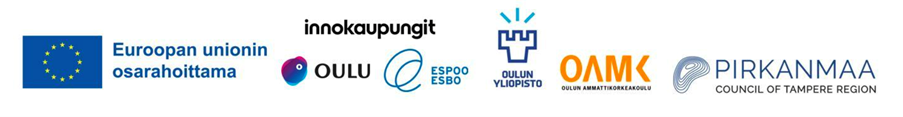

# 📢 XR Year 2026

**[Suomeksi](README.md) · In English**

<picture>
  <source media="(prefers-color-scheme: dark)" srcset="kuvat/finverse-logot-valkoinen.png">
  
</picture>

This project was carried out as part of FINverse, a national development project for metaverse and virtual environments that researches and pilots new digital solutions for the needs of cities.

[](LICENSE-CONTENT) [](LICENSE)

A concise, browser-based overview of XR developments in 2026: devices, platforms, content, regulation, and use in healthcare, defence and industry. The selection pays particular attention to Europe.

🔗Link: [XR Year 2026](https://annaelo.github.io/XR-vuosi-2026/?lang=en)

&nbsp;

## 📚 Material and scope

The material has been compiled from public sources. The exact source is given on the page next to each item.

| Section | Material and sources |
|---|---|
| **XR news** | **XR newsletters:** Immersive Wire, Auganix, VR.org, UC Today<br>**Other sources:** Road to VR, TechSpot, heise online, Meta Connect 2026, ESA XR |
| **XR in numbers** | **Meta Reality Labs:** Immersive Wire<br>**Device shipments:** VR.org (Counterpoint Research, Q2 2026)<br>**Glasses prices:** Road to VR, TechSpot, Netzwelt, Born City, Hifi.de, Instalki, IEEE Spectrum, Mixed |
| **Standards and regulation** | **Developing organisations:**<br>• Khronos Group (OpenXR, glTF 2.0)<br>• Alliance for OpenUSD, Linux Foundation (OpenUSD)<br>• W3C (WebXR Device API)<br>• Metaverse Standards Forum<br>• ISO/IEC JTC 1/SC 24<br>**EU policy and legislation:**<br>• Web 4.0 and virtual worlds initiative, COM(2023) 442<br>• European Parliament resolution on virtual worlds (2024)<br>• General Data Protection Regulation (GDPR), Regulation (EU) 2016/679<br>• Artificial Intelligence Act (AI Act), Regulation (EU) 2024/1689<br>• Digital Services Act (DSA), Regulation (EU) 2022/2065<br>• Data Act, Regulation (EU) 2023/2854<br>• Cyber Resilience Act (CRA), Regulation (EU) 2024/2847 |

**Scope**

- Dates are publication dates, not necessarily the exact dates of the events.
- Prices are indicative. Some euro prices have been converted from other currencies or rounded, and they change with promotions.
- The page does not update itself. The material is stored directly in the file.

&nbsp;

## 🔧 Technical implementation

- Built with the help of an AI tool (Claude Sonnet 5.5)
- A single self-contained index.html: styles, data, JavaScript and image are all in the same file.
- No external libraries and no cookies. The only external service is Google Fonts, which serves the fonts.
- Works on mobile and in light and dark themes. Light is the default, and dark can be selected from the switch in the top bar. The choice is remembered in the browser.
- The page is in Finnish and English. The language can be switched from the button in the top bar (In English / Suomeksi), and the choice is remembered in the browser. The English version can be shared with a direct link: `https://annaelo.github.io/XR-vuosi-2026/?lang=en`.
- The page has three sections, linked from the top bar: XR news, XR in numbers, and standards and regulation.
- The data is in JSON format at the end of the file (<script id="xr-data">). Rows can be added or corrected directly there.

&nbsp;

## 🎨 Visual identity

The look of the page was designed with Claude around the themes of openness, the metaverse, virtual worlds and Finland's Arctic character. The chosen theme, "Napapiiri" (Arctic Circle), is airy and easy to read, and suits a data-driven page.

- **Colours** are taken from the palette of the page's XR figure image. The light theme's background is a snow tone (`#f2f6fb`), the text polar-night blue (`#05103b`) and the accent cobalt (`#103f96`). The dark theme uses polar-night blue as its background (`#06112d`) and light cobalt as its accent (`#8fb0f2`).
- **Topic colours** use the colour-blind-friendly Okabe–Ito palette and are the same in both themes (slightly lighter in dark). A topic's dot is filled when the topic is selected and a ring when it is filtered out.
- **Fonts:** Schibsted Grotesk for headings and body text, IBM Plex Mono for dates and source tags. If the fonts do not load, the page uses system fonts.
- **The XR figure image** sits inside an ice-blue round "midnight sun".
- **Shapes:** 8 px rounded corners on cards, pill-shaped buttons and thin lines, no decorative shadows.
- **Accessibility:** the smallest font size is 12 px, including in charts. Text-to-background contrast meets WCAG AA (at least 4.5:1) in both themes, and keyboard focus is clearly visible.
- **Note:** Colours and fonts are defined as CSS variables at the start of index.html (`:root` and `[data-scheme="dark"]`), so they can be changed in one place.

&nbsp;

## ✏️ Updating the material

Each news item is one row in the `events` list:

```json
{"id": "e46", "date": "2026-10-14", "theme": "laitteet", "europe": false, "title": "Otsikko", "title_en": "Headline", "detail": "Lisätieto.", "detail_en": "Details.", "src": "s33"}
```

| Field | Description |
|---|---|
| `id` | Unique identifier, e.g. `e46`. |
| `date` | `"2026-10-14"` if the day is known, or `"2026-10"` if only the month is known. |
| `end` | Optional end date for a multi-day event, e.g. `"2026-10-15"`. |
| `theme` | `laitteet` (devices), `alustat` (platforms and business), `sisalto` (content and services), `saantely` (regulation and privacy) or `ala` (applications). |
| `europe` | `true` if the item has a European connection. |
| `title`, `detail` | Headline and details in Finnish. `title_en` and `detail_en` hold the English versions. |
| `src` | Source identifier from the `sources` list (e.g. `"s14"`) or several as a list (`["s35", "s36"]`). Add a new source there first: `{"id": "s37", "name": "…", "url": "https://…"}`. The source appears as a link at the end of the details ("Source", or "Source 1", "Source 2" for several). |

The page works out the quarter (Q1–Q4), the timeline date, the topic name and the order of items itself, so rows do not need to be kept in date order. The timeline and its heading extend automatically to new months.

Other data lists:

| List | Content | Fields and notes |
|---|---|---|
| `updated` | Update date (`"2026-10-16"`), shown at the bottom of the page. | No need to change it by hand. A GitHub Actions workflow (`.github/workflows/paivitysaika.yml`) sets it to the day index.html was last changed and saves the change as its own commit. |
| `prices` | Models in the price list. | `group` (`ar` or `vr`), `eur`, `src` and the optional `from` = "from", `approx` = "approx.", `note` and `eu: true` for a European manufacturer. European models are shown as their own group. |
| `figures` | Figures for the charts. | |
| `standards` | Standards cards. | `id`, `org_key`, `cat`, `name`, `org`, `status`, `detail`, `src`.<br>`org_key` sets the card's organisation colour: `khronos`, `w3c`, `ogc`, `aousd`, `oidf`, `msf` or `iso`. The colours are CSS variables (`--o-khronos` etc.).<br>`cat` is the topic: `xr` (XR APIs and design), `3d`, `geo` (geospatial), `id` (identity) or `org` (organisations). |
| `eu` | EU policy and legislation. | `id`, `name`, `org`, `status`, `detail`, `src` and the optional `applies` = "Applies when" and `fi` = "In Finland". |
| `watch` | In development list. | `name`, `status`, `src`. |
| `dates` | Deadlines of EU legislation. | `date`, `title`, `src`. The page sorts them and marks each one "In effect" or "Upcoming" based on the day the page is opened. |
| `reading` | Background reading. | `name` and optional `url`. |
| `sources` | All sources. | `id`, `name` and optional `url` (without it the source is shown without a link). XR news sources have the identifiers `s01`, `s02` … and the standards and regulation sources `x01`, `x02` …. The standards and regulation sources are primarily the organisations' own websites (e.g. Khronos, W3C, OGC, EUR-Lex, European Commission). |

**English texts:** an English version of any text field can be added to the same row by appending `_en` to the field name, e.g. `"title_en"`, `"detail_en"`, `"name_en"`, `"status_en"`, `"org_en"`, `"applies_en"`, `"fi_en"` or `"note_en"` for prices. If the `_en` field is missing, the English page shows the Finnish text. The fixed texts of the page are in pairs in index.html (`data-l="fi"` and `data-l="en"`).

If a row has an invalid date, topic or source, the page leaves the row out and reports it in the browser console.

&nbsp;

## ⚖️ Licence

- **Content** (texts, charts and compiled material): [CC BY 4.0](LICENSE-CONTENT). The material may be used and adapted as long as the author (Anna Eloranta) is credited.
- **Code** (HTML structure, styles, scripts and workflows): [MIT](LICENSE).

The licences cover only the author's own work. Material from the sources cited and linked on the page is subject to its own authors and licences.
